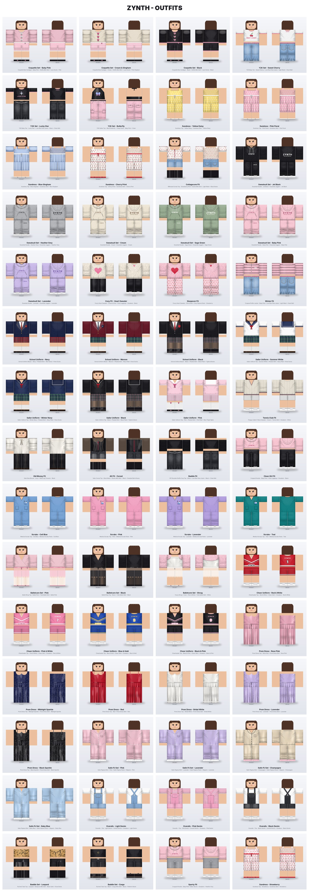
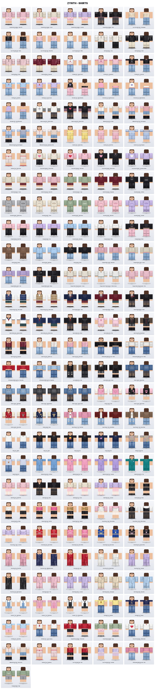
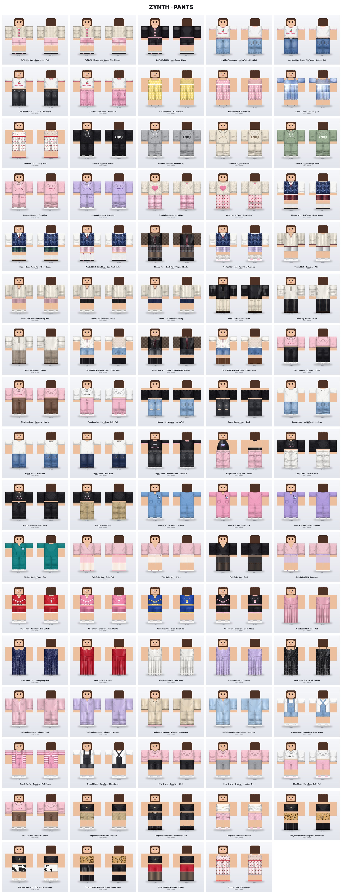
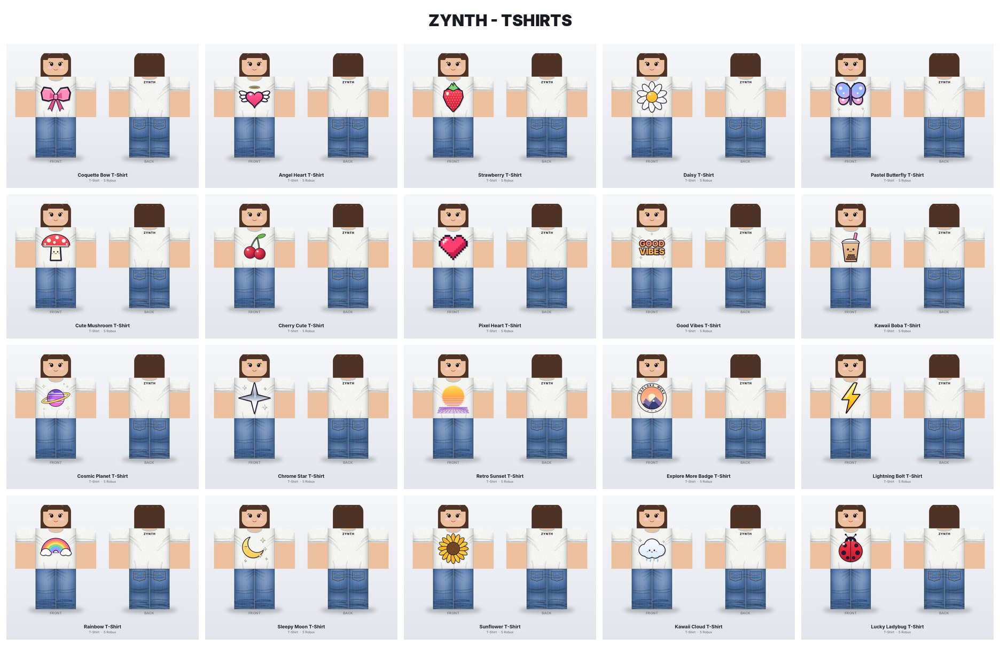

# Roblox Girls' Clothing Pack

245 original, ready-to-upload Roblox clothing items aimed at girls' avatar trends:
**141 shirts, 84 pants and 20 T-shirts**, plus 60 matching outfits. Everything comes from
one Python generator, so you can rebrand or restyle the whole line in a few seconds.

| | |
|---|---|
|  |  |
|  |  |

## What's in `output/`

| Folder / file | What it is |
|---|---|
| `shirts/*.png` | 585×559 classic **Shirt** templates. Upload these files. |
| `pants/*.png` | 585×559 classic **Pants** templates. Upload these files. |
| `tshirts/*.png` | 512×512 classic **T-Shirt** graphics with transparent backgrounds. |
| `previews/*.jpg` | Front and back render of each item on a blocky avatar (not for upload). |
| `outfits/*.jpg` | 60 matching sets: prom dresses, cheer uniforms, sundresses, PJ sets, school uniforms… |
| `LISTINGS.md` / `listings.csv` | A name, description and suggested price for every file, ready to copy. |
| `catalog-*.jpg` | Contact sheets of everything. |

### Collections

- **Coquette**: bow cardigans with lace trim, lace-trim satin camis, satin bow blouses, tiered ruffle
  skirts with lace socks and Mary Janes.
- **Y2K**: baby tees with cute graphics (Sweet Cherry, Sweetheart, Lucky Star, Butterfly, Berry
  Sweet), halter tops, low-rise flare jeans with heart, studded or chain belts, skater layered tees.
- **Cottagecore**: milkmaid corset tops (gingham, strawberry print) and sundresses. Each sundress
  is a top + skirt pair that makes one full dress.
- **Cozy / soft girl**: fuzzy heart sweaters, cable knits, cropped hoodies, cropped puffers,
  hoodie + jogger sweatsuit sets and pajama pants.
- **Preppy / school**: sailor uniform tops, school blazers, sweater vests, V-neck tennis sweaters,
  plaid skirts (with knee socks, bow thigh-highs, sheer tights + boots or leg warmers), tennis
  skirts with sneakers, wide-leg trousers.
- **Alt / baddie**: satin corset tops (one with sheer mesh sleeves), off-shoulder ruffle crop tops,
  denim mini skirts with knee boots, flare leggings, ripped jeans, a goth mesh top, a leather jacket.
- **Denim & layers**: baggy jeans, cargo pants (pink and white with chain belts), denim jackets,
  varsity jackets, open flannels.
- **Balletcore**: ballet wrap tops, fuzzy shrug + cami tops and layered tulle skirts with ballet shoes.
- **Baddie**: ruched tube tops (incl. leopard), cargo mini skirts and bodycon mini skirts (leopard, cow
  print, satin) with boots or sneakers.
- **Formal**: prom dresses in 6 colours, a bodice top + floor-length skirt that together make a gown
  (also works for weddings and royal roleplay).
- **Cheer**: cheerleader uniform tops with matching striped cheer skirts and sneakers.
- **Sleepover**: satin pajama shirts + pants with piping and fluffy slippers; overalls + tee sets.
- **Roleplay**: nurse scrubs (top + pants) in ceil blue, pink, lavender and teal.
- **T-Shirts**: coquette bow, angel heart, strawberry, daisy, butterfly, mushroom, rainbow, sleepy
  moon, sunflower, kawaii cloud, ladybug, cherries, pixel heart, good vibes, boba and more.

Most bottoms come with shoes and legwear already drawn on (Mary Janes, platform boots, knee boots,
chunky sneakers, ballet flats, socks, tights, thigh-highs), so each one is a complete look.

All artwork is original. There are no real brands, logos or characters, which Roblox moderation
rejects. The placeholder brand on the clothes is **ZYNTH**. Swap in your own name (see below).

## Uploading to Roblox

1. Open the Roblox **Creator Hub** and go to the classic clothing upload (Avatar items → Shirts /
   Pants / T-Shirts; Roblox moves this around, so search "upload classic clothing" if you can't
   find it). Upload as yourself or as a **group** if you want earnings to go to a group.
2. Pick the matching type (Shirt for `shirts/`, Pants for `pants/`, T-Shirt for `tshirts/`)
   and choose the PNG.
3. Paste the name and description from `output/LISTINGS.md`.
4. Pay the upload fee and submit, then wait for moderation to approve it.
5. Once it's approved, turn on **sale** and set a price.

**Check before you spend Robux.** Sources disagree on the current rules, and I couldn't reach
Roblox's own docs from where this was built:

- **Upload fee:** most 2026 guides say 10 Robux per classic shirt or pants. One snippet of Roblox's
  docs page showed a higher number. The upload dialog shows the real fee before it charges you.
- **Premium:** third-party guides say you need an active Roblox Premium subscription to put 2D
  clothing on sale.
- **Your share:** Roblox keeps a marketplace cut, so you get roughly 70% of each sale price.

See [create.roblox.com/docs/avatar/classic-clothing](https://create.roblox.com/docs/avatar/classic-clothing)
for the current official rules.

## Tips for actually making Robux

- **Don't upload all 245 at once.** Start with 10–15 likely sellers: the coquette bow cardigan and
  ruffle skirt, a couple of baby tees, flare jeans, a sundress set, a school uniform and pink nurse
  scrubs (roleplay games drive a lot of sales). Add more colours of whatever sells.
- **Sell matching sets.** Upload both halves of an outfit and mention the other half in each
  description (the listings already do this). Sundresses only look like a dress with both halves.
- **Use the trend words.** Names like "Coquette", "Y2K", "Baby Tee", "Cottagecore" and "Preppy" are
  what girls search for. The listings use them, so keep them when you rename things.
- **Price low to start** (5–8 Robux, as suggested in the listings). Cheap items get bought, and
  sales push items up in search.
- **Use a group and a homestore.** Many sellers upload under a group and put the clothes in a
  small "homestore" experience, so players can try them on.
- Be patient. Classic clothing is a crowded market and earnings aren't guaranteed. Consistent
  uploads and good thumbnails matter more than any one item.

### About "UGC"

On Roblox, "UGC" usually means **3D accessories and layered clothing**. Those need 3D models
built in Blender (meshes, cages, textures) and have their own requirements and much higher
publishing costs. This pack is **classic 2D clothing**, the template-based shirts, pants and
T-shirts that most new creators start with. It needs only a PNG upload.

## Avatar compatibility

- **R6 and R15.** The templates use the standard layout, so they wrap both body types.
- Long sleeves stop just above the bottom of the arm, so R15 hands stay skin-coloured.
- Many bottoms include shoes and legwear on the legs and feet. The listing names and descriptions
  say which.
- Crop tops, off-shoulder and halter cuts, short sleeves, the knee rips, lace trims, sheer tights
  and mesh sleeves use full or partial transparency, so the avatar's own skin tone shows through.

## Regenerating / customising

Requires Python 3.9+ with Pillow and numpy (`pip install -r requirements.txt`).

```bash
python3 generate.py                         # rebuild everything into ./output
python3 generate.py --brand NOVA            # print your own brand name on the clothes
python3 generate.py --only hoodie joggers   # only items whose file name contains these words
python3 -m unittest discover tests          # check every template is a valid upload
```

Every build checks each file: correct size, RGBA, and no paint outside the template regions.

To add a colourway, add an entry next to the existing ones in `roblox_clothing/catalog.py`. To
add a new design, write a function in `roblox_clothing/designs/shirts.py` or `pants.py`; the
helpers in `designs/common.py` handle fabric, trims, hoods, shoes, legwear and shading.

| Module | Purpose |
|---|---|
| `template.py` | Exact face coordinates of the 585×559 Roblox template |
| `garment.py` | Paints per face and assembles the final template image |
| `fx.py` | Procedural fabrics: heather, denim, plaid, gingham, satin, mohair, prints, tie-dye, argyle, knits, fishnet |
| `shading.py` | Cloth folds, wrinkles and ambient occlusion per face |
| `details.py` | Bows, lace, ruffles, corset lacing, chains, pearls, zips, buttons, pockets, text |
| `designs/` | The shirt, pants and graphic designs |
| `preview.py` | Avatar previews and contact sheets |
